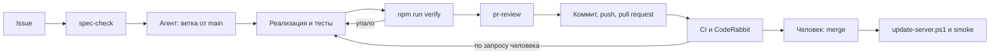

# Доработка по issue и проверка

Issue ведёт разработчик вместе с одним агентом. Агент может быть любым. Пошаговые инструкции для него — `AGENTS.md`. Здесь — кто за что отвечает и чем подтверждается результат.

## Роли

| Кто | Что делает |
|---|---|
| Разработчик | Пишет или уточняет issue, ставит задачу агенту, отвечает на его вопросы, решает по ревью, делает merge и выкладку |
| Агент | Ветка, код, тесты, локальные проверки, коммит, push, pull request. Дальше — только по запросу |
| CI | Повторяет проверки на чистой машине и проверяет обновление базы из `main` |
| CodeRabbit | Ревью diff по `.coderabbit.yaml` |

`main` защищена: в неё попадают только pull request с зелёным CI.

## Issue

Шаблон «Доработка или ошибка»: область, роль, «что сейчас», «что должно быть», 2–5 критериев «Дано / Когда / Тогда». Хотя бы один критерий — негативный: ошибочный ввод или отказ в доступе. Для экранов каждый критерий становится e2e-тестом. Для областей deploy и документации issue называет ручную проверку или скрипт, а в pull request пишут «проверено вручную» и вывод.

Агент останавливается и спрашивает, только если критериев нет, они допускают два прочтения, задача меняет правило предметной области или изменение схемы стирает строки. Для deploy и документации отсутствие e2e само по себе не остановка. Остальное он делает сам.

## Проверки

Результат подтверждается командами, а не отчётом агента.

| Проверка | Команда | Локально | CI |
|---|---|---|---|
| Всё перед коммитом | `npm run verify` | да | по шагам ниже |
| Правка по ходу | `npm run check:fast -- <спеки>` | да, во время работы | нет |
| Seed по контракту | `npm run check:seed` | внутри verify | да |
| Lint | `npm run lint` | внутри verify | да |
| Типы | `npx tsc --noEmit` | внутри verify | да |
| Сборка | `npm run build` | внутри verify | да |
| Сценарии | `npm run test:e2e` | внутри verify | да |
| Обновление базы | `npm run check:upgrade -- <база>` | по снимку от человека; на сервере — внутри `update-server.ps1` до сборки | да, в pull request |

**Seed.** Инварианты `docs/seed-contract.md`, ровно семь заполненных профилей, фикстура совпадает с `data.json` и целая сама по себе.

**Быстрый путь.** Пока идёт работа, полный `verify` на каждую правку не нужен: он занимает около шести минут, и почти всё это e2e. `npm run check:fast -- e2e/<файл>.spec.ts` делает `tsc`, пересобирает проект, если сборка старше исходников, и гоняет указанные спеки на одном воркере: два сервера вместо пяти. Замер на одном файле: 13 секунд с готовой сборкой и 65 секунд с пересборкой против 42 секунд только на запуск пяти серверов в полном прогоне. `lint`, `check:seed` и весь набор сценариев остаются за `verify`, и перед push он обязателен.

**Сценарии.** Playwright в `e2e/`. Тесты идут по production-сборке: `npm run test:e2e` сначала собирает проект (`e2e/ensure-build.ts`) и отказывается собирать, если слушает порт 3000, затем поднимает `next start` — по серверу на воркер, на портах 3101–3104. У каждого воркера своя база `tmp/e2e-<N>.sqlite`, seed загружает её один раз перед стартом сервера. Данные разных воркеров не делятся. Файлы одного воркера идут по очереди и делят его базу, seed между ними не повторяется: спецификация, которая меняет seed-записи, возвращает их сама или заводит свои данные. `.next` у серверов общий и только читается: `next start` не компилирует маршруты, так что параллельные воркеры не мешают друг другу. Отдельный сервер на порту 3100 с базой `tmp/e2e-bootstrap.sqlite` держит базу без админа: на ней `session.spec.ts` проверяет создание первого админа. В базе каждого воркера админа заводит `e2e/seed-admin.ts`, а вход в тесты — один раз на воркер: `e2e/fixtures.ts` получает cookie сессии одним POST `/api/session` и добавляет её в контекст файлов с `test.use({ asAdmin: true })`. Гостевые проверки идут в `describe` с `test.use({ asAdmin: false })`. Число воркеров задаётся `E2E_WORKERS` (по умолчанию 4, столько же в CI на четырёхъядерном runner). Поднимать его на машине разработчика смысла нет: на i5-12450H (8 ядер, 12 потоков) прогон с `E2E_WORKERS=8` занял те же 5 минут, а один файл — 1,5 минуты вместо 12 секунд, потому что девять серверов и девять браузеров стартуют дольше, чем идут сценарии. Локально тесты идут в Edge (Chromium через корпоративный прокси не скачивается), в CI — в Chromium. Перед прогоном dev-сервер на 3000 остановить: сборка и dev пишут в один `.next`. При падении в CI отчёт и трассировка лежат в артефакте `playwright-report`.

**Обновление базы.** То, что произойдёт на сервере после `update-server.ps1`: `migrate()` новой версии впервые открывает базу старой схемы. Содержимое профилей и компетенций эта проверка не переносит. Перезапись каталога из `seed/data.json` на сервере — только ключ `-SyncCatalog`. В CI код `main` собирает базу (`db:seed` и `scripts/upgrade-base.ts` заполняют все таблицы), затем `check:upgrade` открывает её кодом pull request. Проверка работает на копии, запускает `migrate()`, `integrity_check` и `foreign_key_check` и падает, если таблица пропала или в ней стало меньше строк. Сознательная потеря строк записывается в `ALLOWED_LOSS` в `scripts/check-upgrade.ts` — это видно в diff, и такое решение принимает разработчик.

Локально эту проверку стоит прогнать на реальных данных, если pull request меняет таблицы с данными сотрудников или ИПР. Снимок с сервера снимает разработчик: в `C:\apps\programming-profiles` выполнить `npm run db:snapshot -- data\profiles.sqlite <папка вне сайта>\g4-base.sqlite`, перенести файл в `tmp\` и запустить `npm run check:upgrade -- tmp\g4-base.sqlite`. В снимке учётки и хэши паролей: только `tmp/`, никуда не пересылать, после проверки удалить. Копировать базу только через `db:snapshot`: она в режиме WAL, и `Copy-Item` одного файла теряет записи из `-wal`.

## Pull request и ревью

- Описание — по шаблону: `Closes #N`, что изменено, фактический результат проверок, влияние на данные, что сделать после выкладки.
- Ручной коммит человека в ветке issue подписывать `(#N)`, как это делает агент.
- После push CI и CodeRabbit отрабатывают сами. Что делать с замечаниями, решает разработчик и даёт агенту задание. Агент исправляет или отвечает отказом со ссылкой на ADR или правило, затем повторяет проверки.

## Merge, выкладка, закрытие

1. Разработчик смотрит diff и зелёный CI и делает merge.
2. На сервере — `scripts/update-server.ps1` по `docs/update-server.md`. Smoke: сайт открывается, вход проходит, главный сценарий issue работает.
3. Issue закрывается через `Closes #N`. Если выкладка что-то показала — комментарий в issue.
4. Уроки: повторяемый сбой стека — `.cursor/rules/learned-cases.mdc`; продуктовое решение — `CONTEXT.md` или ADR; повторяющееся замечание ревью — `.coderabbit.yaml`.
